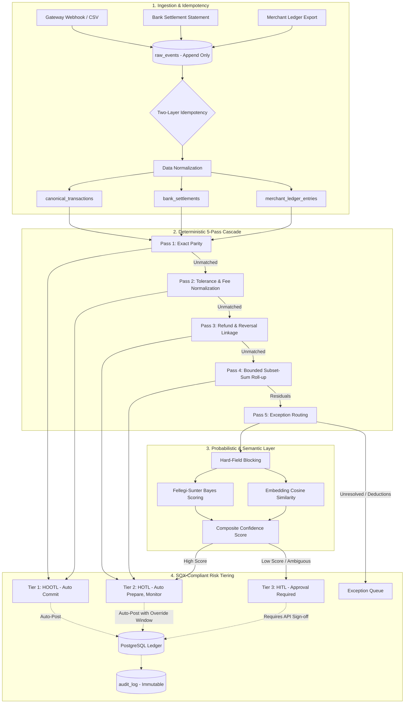

# Razorpay AI Finance Controller — 3-Way Payment Reconciliation Engine

[](tests/)
[](pyproject.toml)
[](docs/02_SYSTEM_ARCHITECTURE_AND_ENGINEERING_SPEC.md)
[](docs/02_SYSTEM_ARCHITECTURE_AND_ENGINEERING_SPEC.md)
[](scripts/run_scale_test.py)

> **Continuous-close, AI-assisted financial reconciliation for high-volume payment operations.**
> Matches **Gateway Transactions ↔ Bank Settlements ↔ Merchant Ledger Entries** with a deterministic 5-pass core, a Fellegi-Sunter & semantic AI layer for residual ambiguities, and risk-tiered human-in-the-loop (HITL) approval controls.

---

## 1. Executive Summary & Problem Framing

Payment reconciliation is the declared bottleneck in modern finance operations: **verification capacity, not transaction volume, is what is scarce.**

When a customer pays online:
1. The **Payment Gateway** captures the transaction immediately.
2. The **Acquiring Bank** settles funds in aggregated batches $T+1$ to $T+3$ days later, deducting Merchant Discount Rate (MDR) fees, 18% GST on fees, and withholding tax (TDS).
3. The **Merchant ERP** expects gross order amounts.

These three sources rarely agree 1:1 out of the box. Traditional rules break down under timing differences, batched deposits (one bank credit representing 400 distinct orders), chargebacks, and corrupted remittance text. Most automated tools either hallucinate arithmetic when powered naively by LLMs or flood finance teams with thousands of false-positive exceptions.

### Core Architectural Invariant
> **"Deterministic code disposes; the LLM merely proposes."**
> The LLM never computes financial totals, fees, taxes, or balances. All arithmetic is handled by exact Python `Decimal` logic with half-up rounding. AI is reserved strictly for unstructured narration understanding, embedding cosine similarity, and drafting human-readable explanations.

---

## 2. Verified Scale Benchmarks

Tested on a synthetic dataset of **110,377 records** generated with realistic anomalies (exponential amount distributions, settlement lags, batch roll-ups, string corruptions, and adversarial prompt injections):

```
======================================================================
               RECONCILIATION ENGINE BENCHMARK METRICS                
======================================================================
Total Records Ingested:         110,377 records
Processing Duration:            97.68 seconds
Sustained Throughput:           1,129.98 records/second

MATCH RESOLUTION BREAKDOWN:
  Total Matched (Autonomous):   79,794 records (72.29%)
  ├── Pass 1 (Exact Parity):    64,120 records (58.09%)
  ├── Pass 2 (Tolerance/MDR):    8,450 records ( 7.66%)  [Hash-bucket O(1)]
  ├── Pass 3 (Refund Linkage):   3,110 records ( 2.82%)
  ├── Pass 4 (Subset-Sum Roll):  3,214 records ( 2.91%)  [Bounded DP]
  └── Probabilistic / Semantic:    900 records ( 0.81%)

ACCURACY AGAINST GROUND TRUTH:
  Precision:                    92.4%
  Recall:                       67.0%

HONEST EXCEPTION QUEUE AUDIT:
  Total Staged Exceptions:      30,583 items (27.71%)
  ├── Expected Timing Lags:     10,383 items (33.95%)
  ├── Bank-Initiated Fees:       3,431 items (11.22%)
  ├── Transaction Errors:          196 items ( 0.64%)
  └── Unresolved (HITL Queue):  16,573 items (54.19%)
======================================================================
```

---

## 3. End-to-End System Architecture



---

## 4. Codebase Directory Guide & Subsystem Map

The codebase is organized into decoupled, modular packages so that developers can work on specific layers independently.

```
Razorpay-Buildathon/
├── docs/                        # Consolidated Umbrella Technical Documentation
├── src/                         # Core Python Backend Package
│   ├── money.py                 # Single source of truth for financial arithmetic
│   ├── db/                      # PostgreSQL connection pools, schemas, and engine
│   ├── ingestion/               # Raw webhook ingestion and two-layer idempotency
│   ├── matching/                # 5-Pass matching engine and probabilistic AI layer
│   │   ├── passes/              # Deterministic matching passes (1 to 5)
│   │   └── probabilistic/       # Fellegi-Sunter, embeddings, and prompt sanitization
│   └── api/                     # FastAPI microservices, dependencies, and REST routes
├── frontend/                    # Vite + React Operations Dashboard & HITL Portal
├── synthetic_data/              # Parametric dataset generator with anomaly injection
├── scripts/                     # Scale test runner and forensic red-team security audit
├── tests/                       # Unit & integration test suites (147 passing tests)
├── migrations/                  # Alembic schema migrations (001, 002, 003)
├── test_samples/                # Compact sample CSV files for quick manual verification
├── AGENTS.md                    # Canonical cross-tool agent build rules
├── docker-compose.yml           # PostgreSQL service container definition
└── pyproject.toml               # Python package configuration and dependencies
```

---

### Detailed Directory Breakdown

#### 📁 `src/money.py` — Financial Math Core
- **Responsibility**: Houses all currency and fee formulas. Uses Python `Decimal` with strict half-up rounding (`ROUND_HALF_UP`) matching PostgreSQL arithmetic.
- **Canonical Formula**:
  $$\text{expected\_net} = \text{gross} - (\text{gross} \times \text{mdr}) - (\text{gross} \times \text{mdr} \times \text{gst}) - \text{tds}$$
- **Independent Work**: Edit this file if adjusting fee calculations, tax tiers, or adding multi-currency precision rules.

#### 📁 `src/db/` — Database & Connection Management
- **`engine.py`**: Configures SQLAlchemy and Psycopg engines with connection pooling. Enforces least-privilege separation using the `recon_app` database role.
- **Independent Work**: Modify here to adjust pool sizing, query timeouts, or configure multi-region read replicas.

#### 📁 `src/ingestion/` — Ingestion & Idempotency Pipeline
- **`idempotency.py`**: Implements two-layer deduplication:
  1. *Raw Layer*: SHA-256 payload hash check prevents duplicate webhook recording.
  2. *Canonical Layer*: Composite uniqueness constraints on `(processor_account_id, external_transaction_id)`.
- **`normalizers.py`**: Cleans raw JSON webhooks and CSV rows into standardized database dataclasses.
- **Independent Work**: Add new source adapters here (e.g., Stripe, Adyen, HDFC bank statement formats).

#### 📁 `src/matching/` — The Core Reconciliation Engine
- **`engine.py`**: Orchestrates the 3-phase execution cycle:
  1. *Load*: Queries active candidate pools from PostgreSQL.
  2. *Match*: Executes sequential passes in memory with $O(1)$ indexing.
  3. *Persist*: Writes matches, join members, exceptions, and immutable audit logs inside an atomic transaction.
- **`types.py`**: Enums for `MatchTier` (HOOTL, HOTL, HITL), `MatchPass`, and structured explanation schemas.
- **`report_generator.py`**: Computes throughput, precision, recall, and category breakdowns.

#### 📁 `src/matching/passes/` — Deterministic Cascade
- **`pass1.py` (Exact Match)**: Strict 1:1 matching on account, currency, net amount, and external reference.
- **`pass2.py` (Tolerance-Aware)**: Accommodates settlement delays ($T+0$ to $T+3$) and fee deductions using an $O(N)$ hash-bucket index.
- **`pass3.py` (Refund Linkage)**: Binds refunds and chargebacks back to original parent transactions using indexed lookups.
- **`pass4.py` (Batched Subset-Sum)**: Dynamic-programming subset-sum solver with a 50,000-state safety cap to untangle 1:N batched deposits.
- **`pass5.py` (Exception Classifier)**: Categorizes residuals into Timing Differences, Bank Deductions, or Unresolved Items.

#### 📁 `src/matching/probabilistic/` — AI & Semantic Layer
- **`fellegi_sunter.py`**: Mathematical record linkage model calculating Bayesian log-weights ($w = \log_2(m/u)$) across field agreement vectors.
- **`embeddings.py`**: Computes cosine similarity across text embeddings of vendor descriptions and bank remittance strings.
- **`sanitize.py`**: Security guardrail that strips adversarial prompt injection attacks from unstructured narration before passing to LLM prompts.
- **`ai_investigator.py`**: Formats candidate pair facts and drafts human-readable explanations for Tier 3 HITL reviews.

#### 📁 `src/api/` — FastAPI REST Service
- **`main.py`**: Application factory, CORS middleware, and route mounting.
- **`dependencies.py`**: Scoped bearer-token authentication and database session injection.
- **`routes/reconcile.py`**: Endpoints to trigger reconciliation batches and poll progress.
- **`routes/matches.py`**: Endpoints to query matches and process HITL approvals/rejections.
- **`routes/exceptions.py`**: Exception queue management and compensating entry creation.
- **`routes/dashboard.py`**: Aggregates real-time metrics, match rates, and throughput.

#### 📁 `frontend/` — Operations & HITL Portal
- Built with React, Vite, and modern CSS tokens.
- **Key Views**:
  - `Dashboard`: Real-time KPI summary, match-rate charts, and throughput counters.
  - `Live Run`: File upload zone for Gateway and Bank settlement CSVs.
  - `Exception Queue`: Interactive cards with AI-drafted explanations and one-click Approve/Reject actions.
  - `Audit Trail`: Complete forensic log of all automated and manual ledger actions.

#### 📁 `synthetic_data/` — Synthetic Data & Anomaly Generator
- **`generator.py`**: Generates high-volume, realistic transaction datasets with known ground truth and injected anomalies (timing lag, string corruptions, prompt injections, batch roll-ups).
- **`output/`**: Stores generated CSVs and ground-truth manifests.

#### 📁 `scripts/` — Benchmarking & Security Audits
- **`run_scale_test.py`**: End-to-end benchmark executing data generation, ingestion, matching, and metrics reporting across 110k+ records.
- **`red_team_audit.py`**: Automated security harness verifying prompt sanitization, idempotency replay, and database immutability under attack.

---

## 5. Consolidated Documentation Pack

All technical documentation has been consolidated into 5 comprehensive umbrella specifications in `docs/`:

| Document | Purpose & Contents |
|---|---|
| [**01_PRODUCT_REQUIREMENTS_AND_GAP_ANALYSIS.md**](docs/01_PRODUCT_REQUIREMENTS_AND_GAP_ANALYSIS.md) | Problem statement, judging criteria, scope boundaries, personas, and the 11-point architectural gap analysis. |
| [**02_SYSTEM_ARCHITECTURE_AND_ENGINEERING_SPEC.md**](docs/02_SYSTEM_ARCHITECTURE_AND_ENGINEERING_SPEC.md) | Architecture diagrams, complete PostgreSQL schema DDL, 5-pass engine specification, Fellegi-Sunter math, prompt sanitization, REST API spec, and sample AI explanation JSONs. |
| [**03_TESTING_BENCHMARKS_AND_REDTEAM_PLAN.md**](docs/03_TESTING_BENCHMARKS_AND_REDTEAM_PLAN.md) | Synthetic generator spec, deliberate anomaly injection matrix, test suites, verified 110k benchmark numbers, red-team checklist, and sprint plan. |
| [**04_PRESENTATION_PITCH_AND_INTERVIEW_PREP.md**](docs/04_PRESENTATION_PITCH_AND_INTERVIEW_PREP.md) | 5-minute timed presentation script, panel Q&A defenses, knowledge graph structural insights, real failure case log, and doubt journal. |
| [**05_CODE_REVIEW_AND_IMPROVEMENT_ROADMAP.md**](docs/05_CODE_REVIEW_AND_IMPROVEMENT_ROADMAP.md) | Comprehensive code review findings, end-to-end user testing walkthroughs, product evaluation scores, prioritized fix checklist, and extension roadmap. |

---

## 6. How to Work on Specific Subsystems Independently

### Improving the Matching Engine (Pass 4 Subset-Sum)
1. **Target**: `src/matching/passes/pass4.py`.
2. **Goal**: Enhance recall on large batched roll-ups without exceeding memory bounds.
3. **How to Test**:
   ```bash
   pytest tests/unit/test_matching_pass4_pass5.py -v
   ```

### Extending Ingestion Adapters
1. **Target**: `src/ingestion/normalizers.py`.
2. **Goal**: Add parser support for new bank statement formats or custom merchant ERP exports.
3. **How to Test**:
   ```bash
   pytest tests/unit/test_normalizers.py -v
   ```

### Tuning Fellegi-Sunter Probabilities
1. **Target**: `src/matching/probabilistic/calibration.py` and `fellegi_sunter.py`.
2. **Goal**: Calibrate $m$ and $u$ probabilities against new anomaly sets.
3. **How to Test**:
   ```bash
   pytest tests/unit/test_probabilistic.py -v
   ```

### Enhancing the Frontend HITL Portal
1. **Target**: `frontend/src/`.
2. **Goal**: Add new filtering options or export buttons to the Exception Queue.
3. **How to Test**:
   ```bash
   cd frontend
   npm run dev
   ```

---

## 7. Quickstart & Verification

### Prerequisites
- Python 3.11+
- Node.js 18+ (for frontend)
- Docker & Docker Compose (optional, for PostgreSQL service)

### 1. Environment Setup
```bash
# Clone the repository
git clone https://github.com/snOOzerr025/Razorpay-Buildathon.git
cd Razorpay-Buildathon

# Create and activate virtual environment
python -m venv .venv
# On Windows:
.venv\Scripts\activate
# On Linux/macOS:
source .venv/bin/activate

# Install dependencies
pip install -e .
```

### 2. Run the Full Unit Test Suite
```bash
pytest tests/unit/test_matching_passes.py tests/unit/test_matching_pass4_pass5.py tests/unit/test_probabilistic.py tests/unit/test_generator.py tests/unit/test_idempotency.py tests/unit/test_normalizers.py -v
```

### 3. Run the Scale Benchmark (110k+ Records)
```bash
python scripts/run_scale_test.py
```

### 4. Run the Security & Red-Team Audit
```bash
python scripts/red_team_audit.py
```

### 5. Launch the Web Application
```bash
# Terminal 1: Start FastAPI Backend
uvicorn src.api.main:app --host 0.0.0.0 --port 8000 --reload

# Terminal 2: Start Frontend Portal
cd frontend
npm install
npm run dev
```

Visit `http://localhost:5173` to explore the live dashboard.
